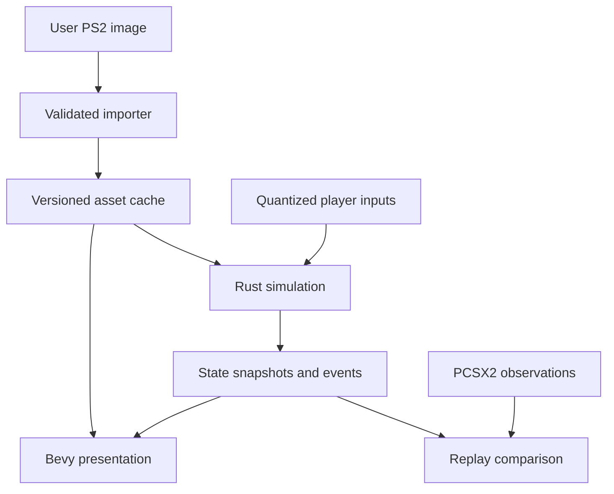

# Gauntlet: Dark Legacy — PS2 to Native PC
## Master design, reverse-engineering strategy, and AI agent development plan

**Prepared:** October 12, 2026  
**Target source:** The user's PlayStation 2 disc image; exact region and revision to be identified.  
**Preferred implementation:** Rust simulation and tools, Bevy desktop client, small Python research utilities, optional C++ emulator instrumentation.  
**Primary targets:** Windows x86-64 and Linux x86-64.  
**Status:** Research-backed project plan. The user's ISO has not been provided or inspected. No local extraction, emulator test, or native build has been performed for this document.

> Build the real game in measured increments: recover original data, establish what the original code does, implement those behaviors natively, and compare the results. A visible level is an asset milestone. A moving character is a movement milestone. Neither proves that the complete game has been ported.

## Contents

1. [Recommendation and feasibility](#1-recommendation-and-feasibility)
2. [Existing work and verified research](#2-existing-work-and-verified-research)
3. [Tools and installation strategy](#3-tools-and-installation-strategy)
4. [What PCSX2 contributes](#4-what-pcsx2-contributes)
5. [Project contracts and repository](#5-project-contracts-and-repository)
6. [Disc, executable, and archive investigation](#6-disc-executable-and-archive-investigation)
7. [Asset recovery specifications](#7-asset-recovery-specifications)
8. [Gameplay reverse engineering](#8-gameplay-reverse-engineering)
9. [Native Rust and Bevy architecture](#9-native-rust-and-bevy-architecture)
10. [Reference capture and differential validation](#10-reference-capture-and-differential-validation)
11. [Milestone execution plan](#11-milestone-execution-plan)
12. [AI agent operating guide](#12-ai-agent-operating-guide)
13. [Quality, performance, packaging, and completion](#13-quality-performance-packaging-and-completion)
14. [Risks and fallback decisions](#14-risks-and-fallback-decisions)
15. [Initial work queue and starter prompt](#15-initial-work-queue-and-starter-prompt)
16. [Sources and research limits](#16-sources-and-research-limits)

---

## 1. Recommendation and feasibility

### 1.1 The recommended route

Use a **PS2-derived native engine reconstruction**, with PCSX2 as the behavioral reference and Ghidra as the static analysis environment. Decode the user's PS2 data into a documented intermediate representation. Reconstruct the simulation in Rust. Use Bevy for the desktop window, rendering, input integration, UI, and presentation.

The finished application must execute native gameplay logic and render through PC graphics APIs. It must not launch PCSX2 invisibly, embed a general-purpose PS2 CPU interpreter, or require a PS2 BIOS to play. Those can be useful development tools, but they do not meet this project's final definition of a native Rust/Bevy port.

A small translated compatibility routine can be useful during investigation. Any remaining executable compatibility layer must be identified explicitly at release; a hybrid native recompiler is a different architecture from a fully reconstructed Rust engine.

Rust and Bevy are a reasonable fit. The difficult part is recovering correct behavior and data, rather than choosing a language. Keep the gameplay core sufficiently independent of Bevy that headless tests can execute it and engine upgrades do not force reverse-engineering changes.

### 1.2 Why this is harder than a DOS port

A PS2 investigation may involve several processing paths: the Emotion Engine's R5900 code, vector-unit programs, the I/O processor and its modules, graphics command construction, sound services, and platform-specific filesystem and memory-card interfaces. The general PS2 architecture is a research concern; the extent to which **this particular build** uses each facility must be measured. PCSX2's source and the open PS2 SDK are supporting references [S4, S9].

For this reconstruction, most hardware-specific work should be replaced at a higher level:

| Original responsibility | Native replacement goal |
| --- | --- |
| Disc reads and archive lookups | Local validated asset cache |
| Hardware-oriented vertex processing | Decoded meshes, skinning, and native materials |
| PS2 graphics packets | Semantic render objects and Bevy rendering |
| Pad reads and multitap handling | Native input devices mapped to fixed player slots |
| Memory-card operations | Versioned profile saves on the host filesystem |
| Console audio playback services | Decoded audio and native event scheduling |
| Console timing and platform services | Explicit simulation clock and host services |

Do not rebuild the entire PS2 to obtain one game's behavior. Conversely, do not assume every vector-unit program is disposable rendering code: verify whether it contributes to collision, physics, or other gameplay results.

### 1.3 Four routes worth distinguishing

| Route | Result | Rust/Bevy fit | Recommended role |
| --- | --- | --- | --- |
| Existing GameCube-based native port | Upstream project's implementation | Requires an architectural change or Rust bridge to reuse extensively | Evaluate separately; potentially faster route to playing if a suitable GameCube image is available |
| Full matching PS2 decompilation | Recovered code rebuilding a specific PS2 executable | Usually an intermediate C/C++ research product | Pursue selectively where it resolves difficult behavior |
| Static PS2 recompilation | Native host code preserving guest execution semantics plus a compatibility runtime | Often C++ with Rust FFI; not automatic Bevy integration | Time-boxed alternative experiment |
| Native PS2-derived reconstruction | Original assets and recovered rules in a new native engine | Strong fit | Main plan |

A matching decompilation of the entire game is **not a prerequisite** for the main route. Recover the functions and data needed for each accepted gameplay slice. A Ghidra pseudocode listing is evidence to interpret, not automatically portable source.

### 1.4 Scope and expectations

This is a substantial reverse-engineering and game-engine project. AI can accelerate bounded analysis, decoder implementation, tests, and native systems. It cannot guarantee discovery of undocumented formats or completeness of gameplay merely by generating a large codebase.

Use two separate success targets:

- **Early success:** an original PS2 level segment with a real animated character, verified movement, one real enemy, an attack, a pickup, and a working exit or transition.
- **Full success:** the supported PS2 revision's complete campaign, progression, content, local multiplayer, audiovisual identity, menus, and reliable saves running natively.

There is no defensible calendar estimate before the archive, animation, collision, and gameplay feasibility gates pass. Treat a full campaign as a sustained project, potentially many months of iterative work, rather than a weekend conversion. This is a planning judgment, not a measured estimate for this ISO.

---

## 2. Existing work and verified research

### 2.1 A real upstream PC-port project exists

The public repository [Gauntlet-Dark-Legacy-PC-Port](https://github.com/sabishii-bit/Gauntlet-Dark-Legacy-PC-Port) describes an alpha native port based on the **GameCube** edition, targeting Windows and Linux and requiring a user-supplied USA GameCube image identified as `GUNE5D`. A releases page is present [S1, S2].

That establishes the project's existence and its stated input requirements. It does not establish that it is complete, that it accepts PS2 data, or that it runs correctly on the user's machine. This research did not execute it. Do not promise PS2 compatibility or import its progress claims as this project's own progress.

**Proposed evaluation:** inspect a pinned revision, build its asset-free tests if possible, examine its architecture and formats, and list reusable concepts. If the user later supplies an appropriate GameCube image, evaluate that route independently. The main plan remains usable with the PS2 ISO alone.

### 2.2 A GameCube decompilation is a useful comparison source

The public [Gauntlet-Dark-Legacy-Decompilation](https://github.com/sabishii-bit/Gauntlet-Dark-Legacy-Decompilation) is a work in progress for USA GameCube Rev 1. Its README also describes Xbox-derived type research with symbol provenance that must be recorded [S3].

This suggests useful cross-platform clues. **Transfer to PS2 is an inference to test**, not proof: function names, formats, structure offsets, endian handling, controls, bugs, content, and rules can differ. Match a proposed correspondence against the user's PS2 bytes or observed execution before adopting it.

Do not silently incorporate external material whose origin conflicts with the project's chosen provenance policy. Record what was consulted, what code was copied, and which claims were independently verified. A project that has consulted recovered source and upstream implementations should not label itself a clean-room implementation.

### 2.3 PS2 archive extraction already has a foothold

The primary-source repository [haekb/gdl_wad_decoder](https://github.com/haekb/gdl_wad_decoder) specifically targets PS2 Dark Legacy's `WAD.BIN`. Its documented model is a count followed by 16-byte entries containing uncompressed size, file offset, path hash, and compressed size; `-1` marks uncompressed entries, otherwise it uses zlib. Unresolved names are retained [S8].

This is an excellent **candidate format**, not a verified description of the user's revision. Validate bounds, byte order, decompressed lengths, hash normalization, and every extraction result. Preserve unknown entries by stable archive identity. Never discard unknown data because a filename dictionary did not recognize it.

The tool's unknown numbering is a convenience; this project's importer should use archive index and hash instead. Different entries with identical hashes must remain distinct until their meaning is resolved.

### 2.4 Other asset references

MeltyTool credits Dark Legacy format work based on MosesofEgypt's `gdl_tools` [S11]. These are leads for independent asset inspection and format comparison. Confirm PS2 support separately for each file family and revision. Do not treat support for GameCube Dark Legacy as support for PS2 textures, animations, or levels.

The direct `gdl_tools` repository could not be read successfully during this research. It belongs in the investigation queue, with its capabilities explicitly unverified here.

### 2.5 Recompilation exists, but is an experiment

[ran-j/PS2Recomp](https://github.com/ran-j/PS2Recomp) describes an experimental toolchain translating PS2 ELF code into C++, together with a runtime and IOP support [S10]. Native translation does not by itself solve Dark Legacy's rendering, asset semantics, audio, or platform services.

If tested, evaluate a small observed routine first. Require measured results before switching the project to recompilation. Do not adopt a fork's promises as guarantees about the upstream tool or this game.

### 2.6 Evidence classifications

Every research entry must identify one of these states:

| State | Meaning |
| --- | --- |
| Verified locally | Supported by this exact disc's bytes or captured execution |
| Verified upstream | Explicitly supported by an identified source; not yet confirmed on this disc |
| Inferred | Plausible explanation awaiting a discriminating test |
| Unknown | Not established |
| Contradicted | A prior explanation failed a recorded test |

Initial unknowns include region, revision, executable sections, debug symbols, overlays, archive layout compatibility, animation encoding, collision format, script model, simulation cadence, RNG behavior, and PS2-specific content differences.

---

## 3. Tools and installation strategy

### 3.1 Required or strongly recommended

| Tool | Purpose | Installation priority |
| --- | --- | --- |
| Official PCSX2 build | Playable reference, guest debugger, memory investigation | First |
| User's own PS2 BIOS dump | PCSX2's documented requirement; not a finished-port dependency [S4] | First for emulator use |
| Ghidra | Static executable analysis, types, xrefs, scripts | Already available if retained from previous projects |
| Ghidra Emotion Engine: Reloaded | R5900-specific analysis and related PS2 tooling [S7] | First; verify compatibility with installed Ghidra |
| 7-Zip or equivalent ISO-aware extractor | Inspect and extract disc filesystem | First; confirm it preserves all files and reports failures |
| Rust via rustup, Cargo, rust-analyzer | Native tools, simulation, and client | First |
| Bevy at one pinned release | Native desktop application | After feasibility audit |
| Git | Versioned research, source, scripts, checkpoint recovery | First |
| Python 3, isolated environment | Inspection, fixture conversion, analysis scripts | First |
| LLVM tools or GNU binutils, `readelf`, `strings`, hex viewer | Independent ELF and binary inspection | First; ordinary host disassembly may lack R5900 extensions |
| Blender | Visual verification of meshes, rigs, transforms, and exports | Asset milestone |
| FFmpeg and audio editor | Inspect decoded audiovisual streams and timing | Audio investigation |
| Cargo test, proptest, cargo-fuzz | Meaningful decoder and behavior validation | As decoders/core appear |

Use Ghidra's documented Java requirement for the chosen release. Do not install several overlapping R5900 extensions into the same project without checking language IDs and loader conflicts.

The Reloaded extension documents MMI/VU0 macro analysis, `.mdebug` recovery, and PCSX2 save-state import [S7]. Save-state format/compression compatibility is a specific toolchain check. Avoid assuming that any PCSX2 state from any version can be imported unchanged.

### 3.2 Needed when PCSX2 instrumentation becomes justified

| Tool | Purpose |
| --- | --- |
| Pinned PCSX2 source checkout | Narrow game-specific tracing additions |
| CMake, Ninja, supported Clang/LLVM on Linux | Current documented PCSX2 build route [S6] |
| Visual Studio C++ tools on Windows | Current documented Windows route [S6] |
| PCSX2 dependency scripts or documented dependency bundle | Reproducible emulator builds |
| LLDB/GDB or Visual Studio debugger | Debug the emulator's host implementation |
| PCSX2 GS dump runner | Compare graphics dump replay outputs [S5] |
| ccache, optional | Speed repeated emulator builds |

Keep this checkout separate from the native engine. Record all patches and the upstream commit. Read the current PCSX2 build instructions for that pinned commit rather than pasting a possibly stale package list into automation.

### 3.3 Optional specialized tools

| Tool | Use only when |
| --- | --- |
| Open ps2sdk / PS2 homebrew toolchain | Need platform headers, calling conventions, or small independently authored test ELFs |
| RenderDoc | Need host GPU investigation; neither a PS2 semantic asset extractor nor a guaranteed PCSX2 capture path |
| Tracy or equivalent profiler | Native CPU/GPU timing and frame pacing need diagnosis |
| IDA or Binary Ninja | A second analyst environment resolves a specific obstacle; not mandatory purchases |
| SQLite | Research catalog grows beyond practical JSON/CSV handling |
| ImHex / Kaitai Struct | Formal binary schemas or interactive structured inspection help |
| MeltyTool / gdl_tools | Independently validate a particular file type's decoding |
| PS2Recomp | Time-boxed native translation feasibility experiment |
| objdiff / matching compiler toolchain | A selected PS2 routine needs matching-decompilation work |

Do not buy paid tools or install a console compiler merely to begin. A native reconstruction does not require the original proprietary PS2 SDK or bit-matching recompilation of the whole binary.

### 3.4 Environment record

Create `docs/toolchain.md` with OS, CPU/GPU/driver, Rust compiler and target, Bevy version, Ghidra/JDK/extension versions, PCSX2 revision, Python lockfile, decoder revisions, and capture settings. Keep `Cargo.lock` and `rust-toolchain.toml` under version control. Use exact revisions for reference software, not a mutable `latest` label.

A dependency update must have a reason and a targeted verification plan. Updating the reference emulator midway through a behavior comparison invalidates the comparison unless it is repeated.

---

## 4. What PCSX2 contributes

### 4.1 Start with its existing guest debugger

PCSX2 documents the built-in debugger under advanced settings, with separate R5900 and R3000 views [S0]. Start by confirming that the selected build exposes the required windows and breakpoint behavior.

Use it to inspect:

- The game's main loop and update calls.
- Pad input reads, player state, position, health, timers, and inventory.
- File requests, archive reads, decompression, and level initialization.
- Entity construction, collision queries, RNG calls, and damage application.
- Platform calls and I/O module interactions when relevant.

Verify whether symbols exist in this executable. Neither the fact that many PS2 games contain symbols nor upstream GameCube symbols establishes PS2 Dark Legacy's symbol coverage.

### 4.2 Guest debugging and host debugging are different

A debug build of PCSX2 helps inspect **PCSX2 itself** with a host debugger. It does not magically recover the game's source. Guest analysis still needs the emulator's guest-aware debugger, symbols, memory maps, or instrumentation.

A host breakpoint in a generated JIT block is not equivalent to a documented guest function breakpoint. Host and guest addresses must never share an untagged address field in the research database.

### 4.3 When a source build becomes worthwhile

Build from source when one of these becomes a real blocker:

1. Repeated scenarios need reliable scripted input and frame/update control.
2. Memory snapshots and guest-function probes need structured export.
3. File and archive reads need low-volume logs with caller and timestamp.
4. Graphics packet inspection requires pre-GS information.
5. Selected guest writes or function entry/exit observations cannot be collected adequately with the GUI.

Use the smallest patch that solves the specific problem. PCSX2's current guide documents `Release`, `Devel`, and `Debug` build modes with different logging and debug-information tradeoffs [S6]. Select deliberately; do not assume every CMake configuration offers identical diagnostic facilities.

### 4.4 Proposed instrumentation contract

The following is **new project tooling**, not a claim that stock PCSX2 already provides an external automation API.

Implement a local bridge with a capability query, protocol version, request IDs, bounded responses, and explicit errors. A loopback endpoint or local IPC channel is sufficient. Bind access locally. Start with read-only inspection and deterministic capture operations.

Proposed capabilities:

| Operation | Meaning and required result |
| --- | --- |
| `get_capture_context` | Disc/build identities, emulator revision, renderer, timing settings |
| `pause_at_boundary` | Pause at an identified safe guest execution boundary |
| `read_guest_memory` | Tagged EE/IOP space, address, length, bytes, bounds outcome |
| `apply_input_schedule` | Quantized PS2 pad values at identified sampling boundaries |
| `advance_reference` | Requested unit: field, frame, guest update, or event; actual progress reported |
| `capture_state` | Relevant guest state and a manifest tying it to the capture context |
| `export_observables` | Versioned canonical state in JSONL or compact binary |
| `install_probe` | Address/profile-qualified guest breakpoint or targeted event probe |
| `capture_asset_read` | Archive/index/offset/size/caller and optional private payload |

There is no assumption that a guest update equals a VBlank or rendered frame. Implement the clock mapping first. If arbitrary update stepping is not reliable, capture continuous execution with indexed probes instead.

### 4.5 Instrumentation correctness requirements

Run reads and state operations on appropriate emulator execution boundaries. Avoid races between EE, IOP, VU, and graphics threads. Probes in JIT paths need explicit invalidation/registration and behavior equivalent to interpreter observations. A hook added only to an interpreter path may capture nothing when recompilers are enabled.

Each log includes source build identity, guest address space, logical update counter when known, field/frame counters, event kind, and payload schema. Record dropped events. Prefer bounded ring buffers and trigger windows over continuous full instruction tracing.

After each emulator patch, replay a baseline scenario with instrumentation disabled and enabled. Compare gameplay observations, scene output, timing progress, and log overhead. Do not treat an instrumented emulator as an unquestionable oracle if the patch changes behavior.

### 4.6 GS dumps are supporting evidence

PCSX2's GS dump runner replays and compares graphics dumps [S5]. It is useful for renderer regression investigation, but a GS dump is not a complete gameplay recording. It does not reconstruct stable entity IDs, collision data, scripts, rigs, or pre-projection world geometry by itself.

Prefer asset files and observations before projection for asset recovery. Screen-space geometry captures are a fallback for particular effects or validation, not the authoritative level model.

---

## 5. Project contracts and repository

### 5.1 Non-negotiable product requirements

1. Import a supported user-provided PS2 image into a local asset cache.
2. Run original-data gameplay in native Rust without an emulator or BIOS at runtime.
3. Preserve the chosen PS2 revision's campaign structure and gameplay rules.
4. Support one to four local player slots with tested join, leave, and reconnect behavior; confirm the original revision's exact semantics during investigation.
5. Provide keyboard controls and modern controllers without changing the simulation rules.
6. Preserve original art, animation, sound, dialogue, UI information, and readable presentation in a fidelity mode.
7. Provide reliable profiles, save migration, backups, and recovery.
8. Support Windows and Linux using the same gameplay core.
9. Maintain explicit evidence and coverage records for every supported content item and behavior family.
10. Make enhancement features optional and separately testable.

### 5.2 Initial exclusions

Online multiplayer, rollback networking, arbitrary user-generated levels, full PS2 hardware compatibility, all regional revisions, AI replacement voices, new story content, and broad modding tools are outside initial delivery. Preserve interfaces that make later extensions possible without building them prematurely.

Higher-resolution native rendering belongs in the base port. Texture upscaling, widescreen behavior, higher display refresh rates, and redesigned UI must follow fidelity validation. They are not evidence that the underlying game has been recovered.

### 5.3 Recommended workspace

| Path | Responsibility |
| --- | --- |
| `crates/gdl_core/` | Deterministic simulation, rules, state, canonical events |
| `crates/gdl_formats/` | Disc-independent binary format readers and validated types |
| `crates/gdl_assets/` | Import pipeline, semantic asset representation, caches |
| `crates/gdl_client/` | Bevy app, rendering, audio presentation, input, menus |
| `crates/gdl_replay/` | Canonical replay format and headless playback |
| `crates/gdl_compare/` | Reference normalization and semantic comparisons |
| `crates/gdl_tools/` | Native command-line inspection and diagnostics |
| `tools/python/` | Research automation and one-off analysis utilities |
| `tools/ghidra/` | Versioned analysis/export scripts |
| `tools/pcsx2_bridge/` | Bridge protocol and narrow emulator patch records |
| `docs/research/` | Evidence, formats, function maps, experiment results |
| `docs/decisions/` | Architecture and fidelity decisions |
| `profiles/ps2/` | Verified revision-specific metadata and address profiles |
| `tests/synthetic/` | Freely distributable generated parser/behavior fixtures |
| `tests/scenarios/` | Scenario definitions and expected event descriptions |
| `private/` | Ignored original binaries, extracted assets, captures, saves |
| `cache/` | Ignored reproducible derived content |

This table is an organizational design, not a demand to create dozens of empty modules before the first experiment. Add components as a milestone requires them. Keep private artifacts out of public commits and CI logs.

### 5.4 Identity contracts

- `BuildId`: verified disc identity plus executable and relevant archive hashes.
- `SourceFileId`: disc path plus content hash; normalize path representation explicitly.
- `ArchiveEntryId`: archive content hash, entry index, and original hash field.
- `AssetId`: semantic family and stable content identity; never an allocator address.
- `EntityId`: native simulation ID with generation where reuse occurs.
- `ReferenceEntityId`: captured guest identity qualified by lifetime and profile.
- `ScenarioId`: fixture, initial state, input schedule, comparison contract.

Names are labels. Hashes and indexed identities remain authoritative when names are unknown or ambiguous.

### 5.5 Code and research provenance

Keep original disc data local. Package code and import tooling separately from retail assets. Document licenses before copying or linking third-party code. The upstream native port identifies its original project code as GPL-3.0-only [S1]; do not assume that code can be transplanted into an MIT project without consequences.

Using PCSX2 as a separate development program and incorporating PCSX2 code into a shipped runtime are different choices. Record copied code and dependencies in `THIRD_PARTY.md`, including exact license variants. Decide the native project's license before extensive code reuse.

Preserve the original ISO and saves read-only. Any modified image, patch, or experimental save uses a separate path. Do not acquire additional commercial game images or leaked SDKs as an agent convenience.

---

## 6. Disc, executable, and archive investigation

### 6.1 Identify the input before analysis

Produce a build dossier:

- Original filename, byte size, and SHA-256.
- Image/container type and disc filesystem findings.
- Volume metadata, `SYSTEM.CNF` contents when present, boot executable path, and serial as actually observed.
- Complete recursive file inventory with lengths and hashes.
- ELF hashes, program headers, section headers, entry point, segments, and symbol/debug sections.
- Candidate archives, audio/video files, IOP modules, additional executable payloads, and suspicious code-containing blobs.
- Region/revision confidence and how identification was established.

Do not hardcode a PS2 serial from memory or assume the GameCube identifier applies. If the image is a CD-style dump, track layout and sector handling may require a different extraction path from a DVD filesystem. Use reported structure, not filename extension alone.

### 6.2 ELF and memory-map analysis

Import with an R5900-aware loader/language. Validate several instructions independently against PCSX2 disassembly. Respect virtual addresses from loadable segments; file offsets are not runtime addresses. Confirm little-endian interpretation for this ELF and separately for each data format.

Investigate:

1. Entry path, initialization, allocators, scene loading, and main update loop.
2. Function boundaries, tail calls, indirect dispatch, switch tables, and callback arrays.
3. Global pointer conventions and references through `$gp`.
4. Branch delay slots, branch-likely behavior, sign extension, packed MMI instructions, FPU code, and VU-related operations.
5. String xrefs, resource names, error messages, assertions, and platform wrappers.
6. Runtime-loaded code or overlays, if observed; identify load identity and address reuse.
7. Existing debug information; record what actually recovers successfully.

Decompilation errors can masquerade as game algorithms. An incorrect calling convention or unsupported instruction can create meaningless pseudocode. For every translated function, review the instruction path around relevant loads, comparisons, arithmetic, and stores.

### 6.3 Archive pipeline

First run a read-only archive inspector. It must reject impossible counts before allocation, detect overlapping/out-of-range entries, retain metadata, and report compression outcomes. Implement explicit little-endian reads for the candidate `WAD.BIN` model only after a sample confirms it.

Build a robust Rust decoder against the validated profile. Preserve archive entry order, offsets, raw size fields, compressed payload hashes, decoded hashes, proposed names, and ambiguity information. Extraction can recover data even if the names remain unknown.

For name recovery, compare the known hash routine against independently sampled paths. Establish case, slash, encoding, and null-termination rules. A dictionary can have false candidates and hash collisions. A filename proposal needs format plausibility and, where possible, a captured runtime lookup.

Never overwrite an entry when two candidates share a hash. Export unknowns to paths built from safe IDs, not untrusted archive strings.

### 6.4 Runtime resource discovery

Trace one level load. Capture archive requests, callers, size/offset, decompression results, and subsequent consumers. Use xrefs and controlled asset inspection to group related records into a level package. Confirm whether resource tables store offsets, indices, hashes, or patched pointers.

A filesystem archive named `WAD.BIN` does not imply that every internal file is a Doom-style WAD. Detect each internal format independently.

### 6.5 Binary parsing rules

Use checked arithmetic and explicit byte readers. Do not cast console bytes onto native Rust structs. Guest pointers remain `u32` addresses until decoded with a known memory context. Host pointers must never be truncated into guest fields.

Limit decompressed output, recursion, vertex counts, dimensions, nesting, and allocation sizes based on a documented policy. Preserve source bytes for unknown fields and emit structured errors with archive identity and byte offset. Negative sentinels must not become huge unsigned allocations.

For every format, publish a schema with offsets, field widths, byte order, versions, invariants, references, confidence, and examples. Synthetic fixtures validate reader mechanics; locally owned samples validate compatibility.

---

## 7. Asset recovery specifications

### 7.1 Recover semantics, not just exportable pictures

Each recovered asset needs a source identity, raw metadata, decoded semantic representation, validation result, and dependency list. Exporting a mesh to glTF is useful for inspection; glTF is not necessarily the lossless authoritative representation of the original engine.

Use a versioned internal representation for source features that standard interchange formats cannot express. Retain original material parameters, animation events, level triggers, collision flags, and unknown fields in sidecar metadata or typed records.

### 7.2 Textures and materials

Investigate only formats actually present. Candidate PS2 issues include paletted textures, CLUT layout, swizzling, channel ordering, alpha range, texture-coordinate conventions, wrap/clamp behavior, mip levels, and graphics-memory layout. The correct decoder depends on the observed format and upload path.

Validation sequence:

1. Decode a small texture with a distinctive known pattern.
2. Compare colors, orientation, alpha, and palette selection against the reference.
3. Identify whether the record describes on-disc pixels, a transfer layout, or already transformed GPU data.
4. Inspect transparent sprites, font atlases, large environment textures, and animated textures separately.
5. Recover material linkage: blending, alpha test, depth write/test, culling, fog, lighting, vertex color, texture animation, and multipass behavior where relevant.
6. Detect gamma assumptions and establish a controlled conversion into the native rendering color space.

Do not apply one generic unswizzle function to every pixel format. Do not assume doubling alpha values is valid for every texture or every blending path. Premultiplied alpha and transparent-edge colors need explicit treatment.

Deliver an inspector with original metadata, decoded channels, palette view, and native/reference comparison. Cache keys include decoder revision so a decoding correction regenerates stale images.

### 7.3 Meshes and vertex streams

Identify header families, chunk tables, object transforms, bounds, material references, vertex encodings, index encodings, and primitive types. If streams contain DMA/VIF-oriented structures, establish how data is unpacked and what the VU program computes before converting it.

Required checks include coordinate handedness, axis order, unit scale, winding, strip parity, degenerate vertices, normals, UV scaling, color interpretation, rigid attachments, bone indices, skinning weights, and per-part materials.

Convert to a semantic mesh representation first. Native rendering uses independent vertex/index buffers. Preserve original primitive/chunk information for comparison, even if the final renderer uses triangles.

Do not use a screenshot-derived mesh as proof of original world-space geometry. Prefer a captured pre-projection stream if disk decoding stalls, and record what information was lost.

### 7.4 Skeletons and animation

Recover bone parentage, bind/rest transforms, animated channels, frame/time encoding, compression, interpolation, loop boundaries, and attachment points. Determine whether clips are quaternion, matrix, Euler, or another representation from evidence.

Inspect multiple frames of a distinctive attack. Compare foot placement, weapon trajectory, facing, root motion, contact timing, and return to idle. Root motion must be applied once: rendering and gameplay movement cannot both consume it without a defined rule.

Animation events may drive attacks, sounds, projectiles, pickups, or state transitions. If stored outside animation clips, link them explicitly. Visual clip duration does not automatically establish damage timing.

Deliver a character viewer with scrubbing, bone overlays, frame/event labels, attachment visualization, and source metadata. Support a native animation evaluator where Bevy's standard animation paths cannot reproduce the source's blending or channel semantics.

### 7.5 Levels, collision, and navigation

Discover the source level graph before inventing level names. Recover static geometry, transforms, rooms/sectors, entity spawns, spawn generators, collision structures, trigger volumes, exits, hazards, doors, moving objects, camera regions, lighting, fog, scripts, and dependencies as present.

Collision geometry can differ significantly from visible geometry. Recover authoritative collision data and its query semantics. Preserve ordering, flags, one-sidedness, step handling, slope behavior, and tie-breaking. Avoid automatically replacing the original collision model with a modern rigid-body engine.

Navigation may use nodes, grids, sectors, bespoke steering, or direct movement with collision. Do not generate a navmesh and call it original behavior. Compare enemy decisions and paths before choosing a native representation.

Build a diagnostic level viewer with independent toggles for render geometry, collision, triggers, spawns, camera constraints, and navigation. Every displayed object should link back to an asset record or captured observation.

### 7.6 Audio and video

Identify containers and codecs from headers and execution paths. Use independent tools only after verifying the supported codec. Recover stream boundaries, sample rate, channel layout, loop points, pitch behavior, bank entries, and event mappings.

Distinguish announcer lines, enemy sounds, player sounds, music, ambience, UI, and movies. Recover priority, retrigger suppression, simultaneous voice behavior, and timing as gameplay/content observations. Decode representative sounds against reference recordings and test looping across boundaries.

Start with high-quality lossless decoded caches where practical. Preserve original stream bytes locally. Document any lossy conversion and its effect on sound identity or loop timing. Bevy audio can be the initial presentation backend; add a dedicated mixer integration only if verified requirements demand it.

### 7.7 UI, text, and fonts

Recover text tables, glyph mappings, atlas coordinates, layout anchors, color coding, icons, menu states, player banners, and accessibility-relevant information. Do not infer font metrics only from texture dimensions.

Reproduce the information hierarchy first. Preserve four-player readability and test unusual numeric lengths. Modern scaling can use native UI while preserving original relative placement. Widescreen must handle camera framing, HUD anchors, and behavior outside the original viewport explicitly.

### 7.8 Content inventory

Generate a manifest with one row per observed content item and fields for source ID, semantic type, dependencies, decoded status, native runtime status, validation scenario, fidelity issues, and release support. Include all campaign areas, playable forms/classes, enemy families, bosses, attacks, pickups, progression requirements, hidden content, audiovisual events, and menus **as discovered**.

Do not populate that list from uncertain memory or from another console's edition. Distinguish unreachable leftovers from reachable content with evidence. Unknown entries remain in the catalog.

---

## 8. Gameplay reverse engineering

### 8.1 Map behavior in dependency order

Recover the loop and input sampling before tuning character movement. Recover collision queries before tuning enemy steering. Recover damage and event timing before testing a boss. The purpose is to explain observed behavior with a minimal verified model.

For each function or behavior family, record:

- Exact build/profile and guest address or resource identity.
- Observed inputs, outputs, memory effects, and call context.
- Proposed types and units, with confidence.
- Disassembly excerpts or links, decompiler interpretation, and uncertainties.
- Controlled experiments that distinguish competing explanations.
- Native implementation location and regression scenarios.

A game may store health in one field but present a derived value elsewhere. Identify the authoritative writer and consumers before exposing an observation as ground truth.

### 8.2 Required subsystem work

| Subsystem | Questions that must be answered |
| --- | --- |
| Clock and update loop | Simulation cadence, paused time, field/frame relationship, loading transitions, time units |
| Input | Sampling boundaries, analog normalization, deadzones, diagonal response, button edges, repeat behavior |
| Player movement | Speed, acceleration, facing, collision response, steps/slopes, knockback, movement/attack coupling |
| Attack states | Startup, active/recovery windows, target selection, projectiles, charged/turbo behavior, combo rules when present |
| Damage | Hit eligibility, invulnerability, armor/modifiers, damage rounding, friendly interactions, contact damage |
| Health and survival | Damage, recovery, pickups, timers, depletion if present, death, continues, respawn |
| Entities | Construction, stable identity, update order, lifetime, pooling, destruction, deferred effects |
| Enemies | State machines, perception, target choice, movement, attacks, spawning, despawning, crowd interaction |
| Generators | Spawn cadence, capacity, activation conditions, damage/destruction, reward rules |
| Pickups and inventory | Ownership, proximity rules, capacity, stacking, consumption, persistence, timing |
| Progression | Experience/stat growth, unlocks, level completion, gates, currencies, purchased effects where present |
| Camera | Follow targets, multiplayer framing, zone constraints, cutscenes, smoothing, input orientation |
| World logic | Doors, switches, traps, moving geometry, event ordering, secrets, transitions |
| Bosses | Phase changes, vulnerabilities, arena logic, scripted events, victory and rewards |
| Saves | Serialization, checksums, flags, character/profile ownership, progression dependencies |
| RNG | State width, seed sources, algorithms, call-site order, independent streams |

These are an investigation checklist, not claims that this disc implements every listed mechanic.

### 8.3 Controlled experiments

Use a copied save or reproducible initial state. Change one factor at a time: one input, one stat, one enemy location, one elapsed-time interval, one player count. Where invasive memory edits are necessary for a probe, label that scenario and keep ordinary gameplay captures as confirmation.

Examples:

- Compare straight and diagonal movement over identical update counts.
- Hold an attack, tap it, then release at successive boundaries to identify edge/hold behavior.
- Hit the same target with controlled stats to distinguish additive, multiplicative, clamped, or table-based damage.
- Repeat a pickup with two simultaneous eligible players to identify allocation rules.
- Let a generator run with and without existing enemies to identify capacity checks.
- Move players to opposite extremes to establish camera constraints and tether behavior.
- Repeat a transition after saving/reloading to identify persistent versus transient state.

Prefer experiments whose possible outcomes separate hypotheses. Repeatedly looking at the same screenshot does not add confidence to a guessed structure.

### 8.4 Numerical fidelity

Preserve integer widths, signedness, overflow behavior where meaningful, quantization, truncation, and rounding. PC floating-point behavior may differ from PS2 behavior, especially around exceptional values and ordering. Recover the numerical contract for sensitive routines rather than translating everything into `f64` or assuming host SIMD is equivalent.

Use exact integer/state comparisons where appropriate and explicit bounded tolerances for floating values. Bit-identical cross-architecture floating simulation is not promised. If reproducibility requires quantization or strict operation order, document it and test it.

### 8.5 RNG and update order

A fixed seed is insufficient if entity iteration order differs. Preserve stable entity ordering, deferred spawn/despawn processing, and event ordering. Avoid gameplay iteration through unordered hash maps. Capture RNG state or call counts at selected boundaries when possible.

Recover whether audio/cosmetic RNG shares the gameplay stream. Separate streams in the native runtime only when doing so does not change gameplay. Cosmetic enhancements must not consume gameplay RNG.

### 8.6 Script and event execution

Determine whether behaviors are table-driven, interpreted, native callbacks, or mixed. If there is bytecode, document instructions, operands, stack/state, control flow, references, wait semantics, and error behavior. Implement only observed instructions initially; unknown instructions produce visible diagnostics rather than silently succeeding.

If the game uses compiled callbacks instead, implement typed handlers tied to verified identifiers. Do not invent a fictional original scripting language merely because a generic scripting architecture seems convenient.

---

## 9. Native Rust and Bevy architecture

### 9.1 Data flow



The native engine consumes semantic data. It does not repeatedly parse opaque PS2 packets during gameplay unless an explicitly bounded compatibility case remains necessary.

### 9.2 Headless simulation contract

The conceptual API is `step(state, input_frame, rules, level_data) -> next_state + events`. It is a design contract, not a demanded literal Rust signature. The implementation may mutate a world in place for performance.

The core owns player slots, entities, rules, collision, progression, RNG, event ordering, and tick state. It does not read wall-clock time, poll physical devices, load files unpredictably during a step, play audio directly, or depend on a GPU.

Either use a standalone Rust world or a narrowly controlled `bevy_ecs` world. Both can work. Select after the first movement slice; the deciding criteria are headless execution, stable ordering, readable state inspection, and test isolation. Full Bevy plugins do not belong in `gdl_core`.

### 9.3 Fixed update schedule

Bevy's official fixed-timestep example demonstrates separate input, simulation, and interpolated presentation [S12]. This project must still **measure the original cadence**, rather than accepting Bevy's default fixed rate.

Proposed simulation phases, revised to match observed ordering:

1. Consume a quantized input frame for every player slot.
2. Apply pending transitions and verified pre-update events.
3. Advance player and enemy behavior states.
4. Resolve movement and collision in the verified order.
5. Generate and resolve attacks/projectiles/hits.
6. Apply pickups, triggers, generators, and world events.
7. Apply health, timers, progression, and deferred lifecycle changes.
8. Update camera intent if it participates in gameplay constraints.
9. Emit immutable presentation events and a canonical snapshot.

This order is provisional. If the original loop resolves a pickup before damage or updates a generator before enemies, the native schedule must reflect that finding.

Render at arbitrary display rates using interpolation between completed simulation states. Handle dropped frames with a bounded catch-up policy; never change attack or depletion timing according to render FPS. Input edges must survive render frames in which zero or multiple simulation steps occur.

### 9.4 Core types and contracts

| Type or service | Required characteristics |
| --- | --- |
| `InputFrame` | Tick index, fixed slots, quantized axes, held buttons and explicit edge semantics |
| `RulesProfile` | Measured revision-specific parameters and algorithms; identity and schema version |
| `GameState` | Canonically serializable state without host handles |
| `LevelData` | Immutable semantic records, stable references, validated dependencies |
| `CollisionWorld` | Original query semantics, deterministic tie-breaking, debug visibility |
| `GameEvent` | Ordered ID, tick, origin, typed payload; presentation can consume once |
| `ReplayHeader` | Build/rules/assets/core compatibility identities, seed or initial snapshot |
| `SaveEnvelope` | Schema version, integrity data, source profile, bounded payload |
| `AssetCatalog` | Stable IDs, dependency graph, decode/import status |

Do not combine original disk layouts and native runtime layouts. Disk structs can retain unknown fields; runtime structs expose established semantics.

### 9.5 Bevy presentation

Split plugins by responsibility: app state, asset loading, world rendering, characters/animation, camera, input adapter, audio, UI, and diagnostics. Compile diagnostics behind a feature or explicit runtime setting where appropriate.

Start with simple materials sufficient to compare geometry. Replace defaults with custom materials for verified vertex lighting, fog, blend modes, cutouts, and effects. Bevy's ordinary PBR settings may change the art significantly; modern physically based lighting is not inherently more faithful.

Maintain a mapping from simulation IDs to render entities. Render entities cannot determine combat results from animation playback or visibility. Interpolated transforms must never be written back into authoritative simulation state.

High display refresh must not duplicate audio events, particles with gameplay consequences, or button edges. Event cursors and lifetime IDs prevent replaying old effects after restore or reconnect.

### 9.6 Local multiplayer

Use one keyboard player initially and up to four controller-backed slots for full delivery. Keep slot assignment stable across device reconnects. Permit explicit reassignment from a menu. Determine the original pause, join/drop, death, continue, inventory ownership, and camera rules before implementation.

Use the observed shared-camera model as baseline. Adding split-screen is a later enhancement if desired, not a presumed original requirement. Tests must include simultaneous pickups, competing attack targets, separated players, death during transitions, and disconnected controllers.

### 9.7 Asset loading and transitions

The importer resolves dependencies and writes a cache manifest. Runtime loading stages a complete level package before committing the transition. Missing mandatory records produce actionable asset IDs and importer instructions.

Keep loading progress responsive. A failed transition must leave the previous valid profile/save intact. Prevent stale asynchronous load tasks from installing data after the user cancels or changes scenes.

### 9.8 Save design

Native saves are versioned separately from source memory-card data. Use atomic replacement, retained backups, checksums or integrity verification, clear conflict handling, and migrations tested against old schemas. Avoid serializing raw Bevy entities or pointers.

Original save import is a separate milestone: decode container and game payload, identify checksums and flags, validate dependent state, and produce a copied native profile. Begin read-only. Do not write to original PS2 saves. Save export back to PS2 is optional future scope.

### 9.9 Enhancement layer

After fidelity gates, add optional widescreen, resolution scaling, texture packs, higher presentation refresh, controller remapping, captions, readability adjustments, and convenient launch settings. Preserve a reproducible baseline mode.

Texture replacement maps by stable asset ID and reports missing/ambiguous mappings. Preserve text and transparent edges. Do not upscale collision, change animation timing, replace core numerical behavior, or consume gameplay RNG as part of visual improvements.

---

## 10. Reference capture and differential validation

### 10.1 Establish the oracle carefully

The exact PS2 image in a pinned PCSX2 setup is the practical behavioral reference. It is still an emulator, and rendering or timing defects are possible. Where hardware evidence is available, use it to resolve disputed observations. Real hardware is helpful, but not a prerequisite to start.

Record reference configuration: image and BIOS hashes privately, emulator revision, patches/cheats, CPU modes, renderer, speedhacks, internal resolution, interlacing, display timing, and save-state identity. Start without gameplay cheats or enhancement patches. Separate diagnostic patches from baseline captures.

### 10.2 Capture package

Each scenario contains:

- Scenario manifest, source build, reference environment, and capture version.
- A copied initial save/state plus reproducible preparation steps.
- Quantized original-pad input schedule tied to sampling/update boundaries.
- Semantic observables at defined points: positions, facing, health, state IDs, inventory, RNG when known, spawn/death/hit/transition events.
- Frame/audio captures as supporting evidence.
- Address profile and normalization logic that produced the observables.
- Expected invariants and comparison tolerances.

Private reference states and recordings stay outside distributable fixtures. A CI job lacking retail data should report owned-data scenarios as unavailable/skipped, never passed.

### 10.3 Align clocks before comparing

Map captured guest updates to native ticks. Verify whether original systems update at different cadences. Loading, interlaced fields, pauses, dropped render frames, and frame-rate patches complicate naive frame matching.

When direct synchronization is impossible, align by semantic anchors such as level-ready, first sampled input, attack-start, projectile-spawn, or exit-activation. Report alignment uncertainty separately from simulation error.

### 10.4 Compare the first divergence

Canonicalize pointers into IDs, normalize coordinate conventions and units, and omit uninitialized/padding bytes. Compare only fields whose meaning has been verified.

Use exact comparison for discrete flags, integer stats, event order, resource selection, and RNG state where recovered. Specify tolerances in source-derived units for positions or floating calculations; calibrate tolerances against repeated reference captures. Do not pick an arbitrary loose tolerance to make a broken test pass.

A mismatch report includes first divergent tick/event, expected/actual values, initial state, input prefix, code/profile identities, and relevant source evidence. Store a minimized reproducer. Visual similarity cannot override a damage or progression mismatch.

### 10.5 Test families

| Family | Main purpose |
| --- | --- |
| Synthetic parser cases | Correct readers, invalid input handling, checked bounds |
| Owned-data decode cases | Compatibility and source interpretation |
| Function probes | Recovered routine behavior across informative inputs |
| Core state tests | Gameplay invariants and update ordering |
| Differential scenarios | Original-versus-native behavior |
| Native deterministic replay | Stable repeated execution under supported conditions |
| Rendering comparisons | Art, camera, transforms, materials, and UI |
| Audio event comparisons | Selection, loop/retrigger rules, timing |
| Full content traversal | Campaign completeness and hidden content coverage |
| Platform/package tests | Fresh import, launch, controls, saves, recovery |

### 10.6 Useful early scenarios

Start with no-input idle, straight/diagonal movement, wall contact, one attack, one enemy encounter, one pickup, one generator, player death, exit transition, save/reload, and two-player camera separation. Expand to four players, every boss phase, every gate, and all reachable content.

A scene populated by placeholder enemies can validate presentation integration. It cannot satisfy an original-enemy behavior gate. Label placeholders prominently and remove them from acceptance demonstrations.

---

## 11. Milestone execution plan

### 11.1 Dependency map

| Milestone | Depends on | Reviewable outcome |
| --- | --- | --- |
| M00 — Charter and evidence policy | None | Clear target, scope, provenance, completion rules |
| M01 — Disc and executable dossier | M00, local ISO | Identified build and validated extraction inventory |
| M02 — Tools and upstream audit | M00; M01 for revision compatibility | Reproducible tools and reuse decision |
| M03 — Reference baseline | M01–M02, local BIOS | Repeatable original-game scenarios |
| M04 — Archive recovery | M01–M02 | Robust indexed extraction without losing unknowns |
| M05 — Texture/material proof | M03–M04 | Original textures rendered correctly |
| M06 — Geometry and first scene | M04–M05 | Original level segment and object in native viewer |
| M07 — Rig and animation proof | M03–M06 | Real animated character with verified timing |
| M08 — Level/collision semantics | M03–M06 | Navigable original-data segment with collision |
| M09 — Loop and input model | M03 | Measured simulation/input contract |
| M10 — Native movement and camera | M07–M09 | Original-data player movement matching reference |
| M11 — Combat, enemy, and pickups | M10 | Small faithful gameplay encounter |
| M12 — Playable vertical slice | M11; minimum audio/UI | End-to-end slice with an exit and persistent result |
| M13 — Progression and world logic | M12 | Authentic persistent gameplay loop |
| M14 — Behavior and content expansion | M13 | Measured coverage of ordinary campaign content |
| M15 — Bosses, scripts, and endgame | M14 | Complete critical campaign path |
| M16 — Local multiplayer | Core from M10 onward; release gate after M15 | One to four players through campaign scenarios |
| M17 — Audiovisual and UI completion | Starts M05; gate after content expansion | Consistent original identity and usable menus |
| M18 — Saves and optional PS2 import | M13; release gate after M16 | Reliable profiles, migrations, recovery |
| M19 — Optional enhancements | Fidelity gates through M18 | Modern presentation without baseline regressions |
| M20 — Performance and platform QA | M15–M19 | Stable Windows/Linux packages |
| M21 — Importer and release qualification | M20 | Fresh-install completion, coverage report, release |

Some workstreams can overlap after their inputs stabilize, but each acceptance gate remains explicit. Audio, save design, UI, and multiplayer smoke tests should begin earlier than their completion milestones. Do not discover that the architecture cannot support four players only after finishing a single-player campaign.

### M00 — Charter and evidence policy

**Objective:** Establish a project that cannot confuse native fidelity with a demo.

**Tasks:** Define the initially supported revision, target platforms, native-runtime requirements, provenance policy, license/reuse strategy, private artifact handling, baseline and enhancement modes, and acceptance categories. Create a coverage ledger and unknowns register. Select one-agent sequential operation as the default; optional parallel work requires explicitly assigned ownership.

**Deliverables:** `docs/charter.md`, `docs/decisions/0001-port-route.md`, `docs/research/unknowns.md`, `docs/coverage.md`.

**Exit:** Every requirement has a measurable acceptance criterion. No unsupported revision, mechanic, or upstream progress is presented as verified.

**If blocked:** Make routine reversible defaults and mark assumptions. A missing ISO does not justify fabricated extraction results.

### M01 — Disc and executable dossier

**Objective:** Know exactly which binary and data are being ported.

**Tasks:** Hash the original image, inspect its actual container/filesystem, extract to an ignored directory, identify the boot executable from observed configuration, inventory all files, and inspect ELF metadata. Detect candidate archive/module/code payloads. Create a revision profile initially containing only established facts.

**Deliverables:** Disc manifest, executable report, extraction log, hashes, initial profile.

**Exit:** Repeating extraction yields the same manifest. All failures and inaccessible files are explained. The boot executable's file offset and runtime address model are distinguished.

**If blocked:** Change the extraction tool based on identified image structure; retain the original. Request the local file only when work actually needs its bytes.

### M02 — Tools and upstream audit

**Objective:** Choose validated tools and useful existing research.

**Tasks:** Pin Ghidra/extension/PCSX2 versions; verify sample instruction decoding. Inspect the upstream native port, decompilation, archive extractor, and asset-tool leads at recorded commits. Build asset-free tests if practical. Record licenses, supported inputs, format overlap, evidence provenance, and possible reuse. Select native reconstruction or document a justified alternative.

**Deliverables:** `docs/toolchain.md`, upstream audit matrix, reuse/provenance decision.

**Exit:** No dependency is accepted solely because its README claims broad compatibility. PS2-specific assumptions are separated from GameCube/Xbox clues.

**If blocked:** Continue with independently verified PS2 research. Optional upstream builds or absent GameCube data must not block the PS2 route.

### M03 — Reference baseline

**Objective:** Establish repeatable observations before modifying behavior.

**Tasks:** Launch the exact image in the selected PCSX2 setup, record configuration, capture startup and a representative initial area, establish guest-debugger operations, create copied reference saves/states, and check repeated scenarios for variation. Measure what stepping unit the available tools actually provide.

**Deliverables:** Baseline environment manifest and scenario package for idle, movement, attack, pickup, transition, and save/reload.

**Exit:** A second run reproduces the recorded initial conditions and observations within explained variability.

**If blocked:** Diagnose emulator configuration first; do not rewrite native mechanics to mimic an emulator glitch. Keep changes documented and repeat captures after reference updates.

### M04 — Archive recovery

**Objective:** Recover every accessible entry while preserving uncertainty.

**Tasks:** Validate the candidate `WAD.BIN` schema; inspect samples with an independent tool; implement a bounded Rust inspector/extractor; verify decoded lengths and hashes; recover names with confidence and collision handling; catalog unknowns; map a first level's resource requests.

**Deliverables:** `gdl_formats` archive reader, extraction command, schema, manifest, invalid-input tests and owned-data report.

**Exit:** Every archive entry has an outcome. Known samples agree with independent extraction. Invalid offsets, sizes, decompression bombs, and filename collisions fail safely or remain clearly recorded.

**If blocked:** Investigate revision differences or actual loader code. Do not adjust offsets arbitrarily until output happens to look plausible.

### M05 — Texture and material proof

**Objective:** Show original art correctly in a native viewer.

**Tasks:** Identify observed texture variants, palettes, layout, channel/alpha semantics, and material references. Decode representative environment, character, font, and transparent-effect samples. Render comparison panels with diagnostic channel views and source metadata.

**Deliverables:** Texture schemas, converters, viewer, cache identity rules, comparison captures.

**Exit:** Representative samples match orientation, color, alpha, and intended blending. Undecoded formats are enumerated rather than substituted silently.

**If blocked:** Trace uploads and consumers. Use narrowly scoped GPU-memory observations to distinguish disk versus upload layouts.

### M06 — Geometry and first scene

**Objective:** Render an authentic level segment and static character/object.

**Tasks:** Recover vertex/index/chunk encodings, transforms, materials, and primitive assembly. Validate coordinate conventions and scale. Build semantic meshes and a native Bevy inspection scene. Export an independently inspectable glTF where possible, with sidecars for unsupported semantics.

**Deliverables:** Mesh parser, semantic scene representation, scene viewer, geometric invariant tests.

**Exit:** No scrambled polygons, mirrored axes, unexplained UV offsets, or guessed replacement geometry in the accepted sample. Bounds and source dependencies are reproducible.

**If blocked:** Capture data before projection and identify the unpacking/transform path. Keep fallback captures labeled and separate from authoritative asset decoding.

### M07 — Rig and animation proof

**Objective:** Recover one real character's idle, movement, and attack clips.

**Tasks:** Decode skeleton and channel formats, implement sampling/interpolation, determine root motion, attachments, loop behavior, and event sources. Compare distinctive poses and attack windows. Record animation-state identifiers independently of native presentation handles.

**Deliverables:** Rig/clip schema, native evaluator, animation viewer, event timeline.

**Exit:** Selected clips preserve pose, duration, attachment motion, and verified event timing. Root motion is not applied twice.

**If blocked:** Trace the original animation sampler over a small clip. Avoid replacing the character's animations with newly authored placeholders as milestone evidence.

### M08 — Level and collision semantics

**Objective:** Separate the visible world from gameplay geometry.

**Tasks:** Recover level records, collision primitives/acceleration structures, spawn tables, triggers, exits, camera constraints, and references. Implement query experiments for walls, corners, steps, slopes, and hazards as present. Produce layered diagnostic visualization.

**Deliverables:** Level/collision schema, importer, query adapter, sample scene diagnostics.

**Exit:** Collision queries agree on representative inputs. The slice has verified spawns and a reachable transition target. Unknown flags and unsupported structures have visible outcomes.

**If blocked:** Trace collision inputs/outputs and sample original queries. A visual mesh-derived collider is allowed for a labeled experiment, not the accepted baseline.

### M09 — Loop and input model

**Objective:** Determine how simulation time and player inputs work.

**Tasks:** Identify update boundaries, clock units, original pad sampling, analog normalization, edge/hold rules, pause semantics, entity update order, and RNG candidates. Build small input/clock probes. Add a minimal PCSX2 source bridge only if stock debugging cannot produce needed evidence.

**Deliverables:** Loop map, input specification, canonical replay schema, reference timing study.

**Exit:** Controlled sequences have unambiguous input boundaries. Native tick rate is justified by evidence; field/frame/tick distinctions are documented.

**If blocked:** Use continuous indexed captures and semantic anchors. Never assume `60 Hz` simply because the target is an NTSC-era console.

### M10 — Native movement and camera

**Objective:** Control an original animated character in original geometry.

**Tasks:** Implement quantized input adapter, movement/facing, verified collision response, animation linkage, camera rules, and headless replay. Measure straight/diagonal travel, contact behavior, and multiplayer camera bounds with a second simulated player.

**Deliverables:** Native movement demo, reference/native scenarios, first-divergence diagnostics.

**Exit:** Specified movement and camera scenarios meet measured tolerances. Rendering at 30, 60, and 144 FPS produces the same core outcomes for the same replay, subject to the supported determinism contract.

**If blocked:** Revisit timing, units, collision, and operation order before tuning magic constants.

### M11 — Combat, one enemy, and pickups

**Objective:** Reproduce a genuine gameplay encounter.

**Tasks:** Recover one player's basic attack, target selection, projectile/contact behavior, damage/health rules, one enemy state machine, one generator if relevant, and representative pickups. Implement deferred lifecycle handling and event-driven sound/effects hooks.

**Deliverables:** Encounter scenario, function/behavior dossiers, semantic state/event comparisons.

**Exit:** A controlled fight yields the same verified attack timing, health change, enemy transitions, pickup result, and destruction/reward sequence. Placeholder AI does not count.

**If blocked:** Minimize the encounter to the earliest differing action. Identify a missing rule from code or a discriminating experiment.

### M12 — Playable vertical slice

**Objective:** Complete a small original-data gameplay loop end to end.

**Tasks:** Assemble spawn, movement, attacks, enemies, pickups, minimum HUD/audio, an exit, level transition, and saved progress. Exercise failure cases and repeated play. Keep scope small enough to inspect fully.

**Deliverables:** A native build, recorded slice walkthrough, acceptance report, updated risk estimate.

**Exit:** The user can start, play, finish, save, restart, and recover progress in the slice. Required original assets and behaviors are verified; it is explicitly labeled a slice.

**Decision gate:** Reassess full-project feasibility. Continue when animation, collision, content loading, and behavior capture scale plausibly. If they do not, document the bottleneck and choose a specific recovery experiment or alternative route.

### M13 — Progression and world logic

**Objective:** Support a faithful persistent game loop.

**Tasks:** Recover progression tables, character/class rules, item effects, gates, switches/doors, timers, death/continue flow, and level results as present. Implement persistence boundaries and data-driven rules only where the original is data-driven. Cover rounding, maxima, stacking, and simultaneous events.

**Deliverables:** Rules profile, progression state machine, world-event handlers, persistent scenario suite.

**Exit:** Progress can be acquired, retained, and used to unlock the expected next state. Save/reload and death cannot duplicate rewards or lose necessary progression.

**If blocked:** Trace authoritative table consumers and save writers; do not import another edition's progression values without verification.

### M14 — Behavior and content expansion

**Objective:** Scale from a slice to all ordinary campaign content.

**Tasks:** Inventory discovered areas and behavior families; process assets in dependency order; recover each distinct enemy/generator/attack/pickup family; implement exceptions as evidence-backed handlers. Batch similar variants only after establishing that they share logic. Add scenarios for hazards, secrets, unusual transitions, and character forms as discovered.

**Deliverables:** Content coverage matrix, expanded format support, encounter library, traversal builds.

**Exit:** Every ordinary reachable content item has a supported or explicitly blocked status. All claimed supported areas can be traversed with expected progression; loading alone is not completion.

**If blocked:** Prioritize blockers on the campaign critical path, then completeness. Never delete unsupported records to make import statistics look better.

### M15 — Bosses, scripts, and endgame

**Objective:** Complete the critical campaign path and special-case logic.

**Tasks:** Recover each boss's phases, vulnerabilities, arena events, attack patterns, rewards, and victory conditions. Implement discovered script/callback semantics. Recover required late-game gates, finale transitions, ending presentation, and post-completion state.

**Deliverables:** Boss behavior dossiers, phase scenarios, full critical-path playthrough report.

**Exit:** A supported profile reaches the expected ending through legitimate native gameplay and persists its completion state. All required phase and gate transitions have evidence and regression scenarios.

**If blocked:** Isolate arena scripts and state transitions. A boss that animates and takes damage without authentic phase behavior remains incomplete.

### M16 — Local multiplayer completion

**Objective:** Preserve the game's cooperative experience.

**Tasks:** Complete slot assignment, original join/drop and continue semantics, shared camera, interactions, reward/pickup ownership, simultaneous attacks, device reconnects, and profile ownership. Test two, three, and four players. Begin smoke tests during M10–M12; finish all content coverage here.

**Deliverables:** Multiplayer scenario matrix, controller UI, co-op traversal/soak results.

**Exit:** Stable player slots and progression through representative ordinary and boss areas at every supported count. No duplicated events, lost profiles, trapped camera states, or silent reassignment.

**If blocked:** Reduce to a two-player reproducer. Check ordering and ownership rather than adding arbitrary multiplayer exceptions.

### M17 — Audiovisual and UI completion

**Objective:** Restore the recognizable presentation throughout the game.

**Tasks:** Finish sound/music/announcer event mapping, loop behavior, voice priority, movies where present, particles, lighting/fog, materials, HUD, menus, credits, and text. Compare representative scenes and all critical UI flows. Verify player colors, readable numeric displays, subtitles/captions where supported, and all audio dependencies.

**Deliverables:** Audiovisual event catalog, presentation comparison report, full menu flow tests.

**Exit:** Required content has original audiovisual assets and correct event selection/timing. Missing dialogue or UI is visible in the ledger, not masked by generic substitutes.

**If blocked:** Separate incorrect event selection from decoding/mixing or rendering issues. Fix the responsible layer.

### M18 — Saves, migrations, and optional PS2 import

**Objective:** Make progress durable and recoverable.

**Tasks:** Complete atomic saves and backups; test interruptions and corrupted files; implement schema migrations; exercise profile/character ownership across co-op sessions. If original-save import is included, decode the user's copied memory-card save and migrate verified fields with a readable report.

**Deliverables:** Save specification, migration fixtures, recovery UI, import report if implemented.

**Exit:** Old supported native saves survive upgrades; interrupted saves preserve a recoverable prior state. Original save files remain untouched. Optional PS2 import is not claimed until its checksum and progression semantics are verified.

**If blocked:** Preserve a read-only profile extractor and defer PS2 import; native-save reliability remains required.

### M19 — Optional enhancements

**Objective:** Improve modern PC presentation without destabilizing fidelity.

**Tasks:** Add widescreen/aspect handling, native high-resolution options, remapping, optional texture replacements/upscales, higher presentation refresh, accessibility settings, and useful diagnostics. Keep enhancement choices out of simulation unless a separately labeled gameplay mode is intentional.

**Deliverables:** Enhancement settings, baseline toggles, compatibility test matrix.

**Exit:** Baseline differential scenarios still pass. Widescreen does not break visibility, camera constraints, triggers, or HUD; high display refresh does not alter gameplay speed.

**If blocked:** Ship the fidelity mode and leave the failing enhancement disabled or unfinished with clear status.

### M20 — Performance and platform QA

**Objective:** Deliver predictable desktop behavior.

**Tasks:** Profile import, loading, simulation, animation, rendering, audio, and peak memory. Fix measured hotspots. Test supported Windows/Linux environments, keyboard/controllers, focus loss, fullscreen/resizing, device changes, low disk space, and long co-op sessions. Capture release-build identities and frame pacing.

**Deliverables:** Performance report, platform test matrix, optimized release candidates.

**Exit:** Stated performance targets are met on named hardware with representative worst-case content. No debug-only dependency or private developer path is required to run.

**If blocked:** Identify the limiting subsystem and degrade optional visuals before changing core rules.

### M21 — Importer and release qualification

**Objective:** Ship a reproducible native application, not a developer workspace.

**Tasks:** Build an import-first workflow for supported images; validate version mismatch messages, cache rebuilding, missing dependencies, cancellation, interrupted conversion, and updates. Test a fresh user account with no extracted assets. Verify licenses, source notices, private-data exclusion, support docs, and complete coverage ledger.

**Deliverables:** Windows/Linux packages, importer, user guide, supported-build list, known-issues file, final acceptance report.

**Exit:** A fresh installation imports a supported image, launches natively, supports the advertised campaign/co-op features, saves/reloads reliably, and does not require a BIOS or PCSX2 at runtime. Report remaining limitations precisely. Unsupported revisions are rejected rather than misinterpreted.

**If blocked:** Release only with a scope label consistent with the coverage report—technical preview, slice, alpha, or supported complete port.

---

## 12. AI agent operating guide

### 12.1 Work in bounded evidence-producing tasks

Use one focused task per implementation cycle. A task should state the behavior or format to recover, available evidence, relevant files, uncertain assumptions, intended experiment, required artifact, and acceptance condition. Avoid issuing a single command to “decompile and recreate the whole game.”

A productive loop is: inspect evidence, state hypotheses, run a discriminating experiment, implement the justified result, compare, document confidence, commit a coherent change, then move to the next dependency.

### 12.2 Task packet template

```yaml
task_id: M11-DAMAGE-001
objective: Recover and implement one basic attack's damage application
source_profile: <verified profile ID>
inputs:
  - <function dossier>
  - <private reference scenario ID>
unknowns:
  - <specific rounding or modifier question>
implementation_scope:
  - crates/gdl_core/<actual module>
experiment:
  - <input variations that distinguish candidate formulas>
acceptance:
  - <exact state/event contract or justified tolerance>
outputs:
  - <native behavior>
  - <comparison report>
  - <updated dossier>
stop_condition:
  - <missing evidence that makes implementation speculative>
```

The angle-bracket fields are required substitutions, not known addresses or pre-existing filenames.

### 12.3 Research roles

A single agent can perform these roles sequentially. If parallel agents are explicitly authorized later, assign non-overlapping files and one integration owner.

| Role | Responsibility | Cannot decide alone |
| --- | --- | --- |
| Binary analyst | Function maps, structures, numerical contracts | Declare native behavior correct without comparison |
| Format analyst | Schemas, archive/asset decoding, independent checks | Silently drop unknown records |
| Reference investigator | Captures, probes, clock/input mapping | Promote unstable captures to ground truth |
| Core implementer | Native state/rules/collision/order | Fill missing rules with plausible game design |
| Presentation implementer | Bevy visuals, animation, audio, UI | Change authoritative state from render callbacks |
| Validation reviewer | First divergence, coverage, acceptance evidence | Mark unavailable tests as passing |
| Integration owner | Contracts, revisions, save compatibility, release scope | Hide gaps to meet a date |

### 12.4 Evidence record template

```text
Question:
Exact source/profile:
Observed code or data location:
Experiment and initial conditions:
Observations:
Competing explanations:
Conclusion and confidence:
Unresolved conditions:
Native implementation:
Regression scenarios:
External sources and provenance:
```

A decompiler-derived guess belongs under competing explanations until supported. Rename functions to descriptive provisional names where useful, and record the distinction between original symbols and analyst-assigned names.

### 12.5 Proposed project AGENTS.md rules

Install these rules in the actual project once its repository exists:

1. Read the charter, active milestone, current profile, unknowns register, and relevant dossier before making changes.
2. Never invent binary addresses, source layouts, filenames, original constants, compiler flags, or test results.
3. Label guesses and placeholders; they cannot satisfy fidelity gates.
4. Keep original binaries, assets, captures, BIOS, and memory-card saves local and ignored.
5. Preserve source identity and unknown bytes through extraction/conversion.
6. Verify source revision and address space before probes or imports.
7. Prefer the smallest meaningful experiment; do not collect unbounded full traces by default.
8. Review relevant disassembly before translating a pseudocode-dependent rule.
9. Keep simulation independent of render FPS and presentation state.
10. Do not upgrade pinned tools or reference software without recording the reason and rerunning affected comparisons.
11. Run meaningful relevant tests. Clearly distinguish synthetic tests, owned-data comparisons, skipped tests, and unavailable fixtures.
12. Update research and coverage as part of the implementation change.
13. Retain first-divergence reports and minimized reproducers.
14. Stop speculative implementation when missing evidence affects the contract; pursue an independent useful task if available.
15. Do not change the project's route, supported edition, or license silently.
16. Report a concrete artifact and the scope of verification at each milestone.

These are project instructions, not an installed skill or a request to run current agents in parallel.

### 12.6 Example focused agent prompts

**Archive task:**

> Read the identified PS2 profile and archive dossier. Validate the candidate archive header and entry fields against local bytes. Implement an inspector that retains every entry, limits decompression and allocations, detects invalid ranges and duplicate hashes, and emits stable indexed identities. Compare representative outputs with the pinned reference extractor. Do not infer success from recognizable filenames alone. Report unsupported entries and uncertainties.

**Movement task:**

> Read the loop/input/collision dossiers and the straight/diagonal/wall scenarios. Implement the minimum native movement rule justified by those observations. Run headless differential comparisons and identify the first divergence. Do not tune constants until timing, units, collision, and update order have been checked. Keep presentation interpolation outside authoritative state.

**Animation task:**

> Decode one verified rig and attack clip. Establish bind transforms, channel interpolation, root motion, attachment points, and event timing. Build a scrubbable viewer and compare selected source poses. Do not substitute new animation, infer hit timing from visual contact alone, or erase unknown fields.

**Boss task:**

> Recover one boss's phase and arena logic from the exact PS2 build. Create a phase graph supported by functions, tables, or experiments. Implement each supported transition and attack family with scenarios covering vulnerabilities, timers, death, rewards, and co-op target selection. A visually convincing fight does not satisfy this task without state/event agreement.

### 12.7 Managing limited context

End each work cycle with a compact state file: current milestone/task, source/profile hashes, established facts, active hypotheses, changed files, test commands/results, first unresolved divergence, and next useful action. Keep large raw outputs in private files and link them from dossiers instead of repeatedly pasting them into agent context.

Provide narrow Ghidra exports around relevant callers/callees and structures. Avoid a single giant decompiler dump. Version exported symbols/types and record the script/tool version that produced them.

---

## 13. Quality, performance, packaging, and completion

### 13.1 Acceptance dashboard

The dashboard should track concrete numerators and denominators, with the denominator itself marked provisional until the content inventory stabilizes. Separate:

- Archive entries extracted successfully.
- Assets decoded by semantic family.
- Reachable areas imported and traversable.
- Behaviors implemented and compared.
- Boss phases and campaign gates verified.
- Multiplayer scenarios passed by player count.
- Audiovisual events mapped and validated.
- Save schemas and recovery cases tested.
- Unknown/blocked items on the critical path.

A large number of decoded assets does not offset a missing final boss or broken save system. Do not call a decoder “100% complete” when its input inventory is incomplete.

### 13.2 Required validation matrix

| Dimension | Required checks |
| --- | --- |
| Builds | Exact supported PS2 revision; wrong/unknown builds rejected with explanation |
| Platforms | Windows/Linux release binaries and fresh user profiles |
| Display | Baseline aspect, supported widescreen, resize/fullscreen, different refresh rates |
| Inputs | Keyboard, multiple controllers, disconnect/reconnect, focus loss |
| Players | One through four, join/drop/death/continue and transitions |
| Content | Every reachable area, required gate, boss phase, supported playable form |
| Persistence | New profile, normal save/load, migration, corruption, interruption, backup recovery |
| Assets | Fresh import, repeat import, decoder upgrade, cache invalidation, missing file |
| Time | Pause, loading, low/high render FPS, bounded simulation catch-up |
| Audio | Loop boundaries, simultaneous events, priorities, duplicate-event prevention |
| Packaging | No private data, no developer paths, dependency notices, runtime startup |

### 13.3 Performance targets

Use a named baseline machine and worst-case test scenes. Proposed initial product targets are 1080p/60 presentation with comfortable simulation headroom, scalable resolution, and optional higher refresh when supported. These are goals, not measurements or compatibility guarantees.

At 60 Hz the whole displayed frame has approximately 16.7 ms. Measure simulation, render preparation, GPU, audio, and stalls separately; CPU/GPU work can overlap, so do not sum unrelated timings blindly. If the original simulation cadence differs, retain that cadence and adjust the presentation budget separately.

Track median and high-percentile frame times, update time under maximum entity load, peak RAM/VRAM, import time, level load time, and long-session growth. Optimize observed bottlenecks with asset reuse, precomputed decode results, batching, stable query structures, and bounded work. Avoid sacrificing fidelity for benchmarks.

### 13.4 Import and update behavior

An importer should:

1. Accept a local user-selected image and validate its profile.
2. Explain supported versus unknown revisions.
3. Inspect space requirements before conversion.
4. Extract/decode to a staging directory with progress and cancellation.
5. Validate manifests and mandatory dependencies.
6. Atomically publish a complete cache; preserve a prior usable cache on failure.
7. Record converter/tool identities and checksums.
8. Regenerate only invalidated outputs after an update.

Schema versions, converter versions, source identity, enhancement options, and dependency identities belong in cache keys. A renderer-only update should not force a full disc import unless it changes the asset contract.

### 13.5 Completion definition

A **complete supported-revision port** requires all of the following:

- The critical campaign path completes from a fresh native profile.
- All claimed supported reachable content and character/behavior variants have coverage.
- Local co-op works across the advertised player counts and content.
- Combat, collision, progression, gates, death/continue, and persistence satisfy documented fidelity checks.
- Required audiovisual content and menus are functional and recognizable.
- Fresh installations import supported PS2 data and launch without PCSX2 or a BIOS.
- Saves are reliable across supported updates and interruptions.
- Windows/Linux packages pass the stated environment matrix.
- Known limitations do not contradict the release's advertised scope.

A prototype can ship earlier under a narrower label. Never hide a remaining compatibility interpreter, mocked behavior, incomplete content, or unsupported save import in a “complete native port” claim.

---

## 14. Risks and fallback decisions

| Risk | Detection | Preferred response | Fallback and consequence |
| --- | --- | --- | --- |
| Existing port already solves the user's practical goal | Upstream audit plus an actual compatible-input test | Evaluate using/contributing upstream separately | Rust/PS2 project remains a different goal |
| GameCube clues differ from PS2 | Failed layout/behavior comparison | Recover PS2-specific facts | Narrow reuse to terminology or concepts |
| No usable debug symbols | ELF inventory and loader results | Strings/xrefs/probes/function maps | More manual analysis; no fabricated symbol recovery |
| Archive differs by revision | Invalid entry ranges or mismatched decompression | Trace actual loader and add revision schema | Support one verified revision initially |
| Animation format is difficult | Pose/event comparisons fail | Trace sampler on short clips | Reduced slice scope; animation fidelity remains blocked |
| Geometry depends on VU programs | Unpacked data lacks semantic vertices/transforms | Recover relevant program semantics or pre-projection output | Narrow compatibility code with explicit status |
| Collision is poorly understood | Corner/slope/query mismatches | Recover authoritative query algorithm and flags | Approximation only in clearly labeled prototype |
| Main-loop timing misunderstood | Systematic drift or input mismatch | Measure sampling/update boundaries | Event-aligned comparisons with uncertainty reported |
| RNG/order drift | First divergence at spawn/drop/target choice | Preserve ordering and recover streams | Scenario-specific probes before broader content |
| Scripts or callbacks remain unknown | Level stalls or missing events | Isolate handlers/opcodes on critical path | Release fewer supported areas, never claim full campaign |
| Bevy materials change appearance | Geometry correct but reference visuals differ | Fidelity materials and controlled color pipeline | Defer modern lighting |
| Static recompilation becomes a hardware project | Routine translation works but game needs broad runtime | Keep experiment bounded and review route | Adopt hybrid architecture explicitly or return to reconstruction |
| AI produces plausible false rules | No supporting dossier or comparison | Reject assumption and design experiment | Placeholder remains outside acceptance scope |
| Tool/trace churn consumes effort | High maintenance with little new evidence | Minimal probes, pinned revisions, bounded capture | Manual debugger workflow for rare cases |
| Save corruption or progression loss | Failure-injection and migration tests | Atomic writes, backups, verified migrations | Disable unverified PS2 save import |
| Scope expands before a slice works | Enhancement work outruns fidelity ledger | Protect vertical-slice gate | Defer nonessential features |

### 14.1 Decision points

**After M02:** Choose how existing upstream work affects the project. Do not abandon the PS2 route silently just because a GameCube project exists.

**After M04–M09:** Confirm that original assets, animation, collision, and timing have a plausible recovery route. A bottleneck should have a specific hypothesis and bounded experiment.

**After M12:** Estimate the remaining work from actual format/behavior coverage and recurring versus unique content. Decide whether the full reconstruction is viable at the desired effort.

**Before M19:** Confirm baseline gameplay and content fidelity before enhancing presentation.

**Before M21:** Release scope follows evidence. Honest limitations are preferable to an unsupported completeness claim.

### 14.2 Bounded recompilation experiment

If the main route stalls on binary logic, evaluate PS2Recomp in a separate branch and directory:

1. Pin the toolchain and inspect supported instruction/runtime behavior.
2. Select one observed, side-effect-bounded function with established inputs/outputs.
3. Translate and compile it; compare results with reference probes.
4. Inventory guest memory, syscall, IOP, VU, graphics, and timing dependencies.
5. Decide whether it can accelerate selected logic recovery or warrants a full route change.

Do not let success on arithmetic imply that the complete game can boot. Integrating generated C++ through Rust FFI also requires explicit guest memory, lifetime, error, and synchronization contracts. Bevy cannot display original GS packets merely because the CPU code compiles.

### 14.3 Matching decompilation experiment

Use matching decompilation when instruction-level equivalence would reduce a specific uncertainty. First identify compiler/ABI evidence; do not guess a proprietary toolchain. Preserve original versus recovered names, verify function boundaries and relocations, and compare code with the proper tool.

A full matching binary can still require platform replacement to become a PC game. Conversely, validated native behavior can be useful without a matching binary. Choose the method that resolves the active question.

---

## 15. Initial work queue and starter prompt

### 15.1 First practical actions for the user

1. Install a current official PCSX2 build and configure a BIOS dump from your own console according to its setup documentation.
2. Confirm the ISO boots and plays; keep a plain baseline configuration.
3. Install a compatible Ghidra Emotion Engine: Reloaded extension alongside the existing Ghidra setup.
4. Have Git, Rust/rust-analyzer, Python, and an ISO extractor available. Blender becomes useful when mesh recovery starts.
5. Preserve the original image and any saves, then provide the local image path to the development agent when beginning M01.
6. Start the repository with this plan and ask for M00–M02. Defer custom PCSX2 compilation until a concrete capture blocker emerges.

The existing GameCube-native port is worth inspecting early. It does not require you to change this plan or assume your PS2 image will work with it.

### 15.2 Initial implementation tickets

| Ticket | Action | Evidence of completion |
| --- | --- | --- |
| INIT-001 | Define charter and unsupported-input policy | Accepted scope and unknowns register |
| INIT-002 | Hash and inventory the user's image | Reproducible disc manifest |
| INIT-003 | Identify boot executable and memory model | ELF report with observed paths/addresses |
| INIT-004 | Audit symbols and runtime code loading | Explicit symbol/overlay findings |
| INIT-005 | Pin Ghidra/extension/reference emulator | Recorded compatible toolchain |
| INIT-006 | Audit upstream projects and licenses | PS2 relevance and reuse matrix |
| INIT-007 | Capture a repeatable initial scene | Reference environment and scenario |
| INIT-008 | Inspect candidate archive headers | Bounds-checked format report |
| INIT-009 | Extract archive without discarding unknowns | Indexed manifest and sample comparisons |
| INIT-010 | Identify one texture and one mesh family | Source-linked decoding hypotheses |
| INIT-011 | Investigate loop/input sampling | Clock/input probe plan and findings |
| INIT-012 | Select the vertical slice | Small original-data content/behavior checklist |

Tickets can close with a well-supported negative finding. “This revision has no usable `.mdebug` section” can be useful progress if actually verified. “Probably stripped” is not a completed audit.

### 15.3 Copy-ready starter prompt

> You are developing a native Windows/Linux port of the user's PlayStation 2 copy of Gauntlet: Dark Legacy, using this master plan as the controlling design document. The primary route is a PS2-derived native Rust simulation with Bevy presentation. PCSX2 is a development reference, not the finished runtime. Existing GameCube/Xbox research is optional evidence and must be validated against the exact PS2 revision before use.
>
> Begin with M00–M02 only. Inspect the workspace and project instructions, establish the charter and evidence policy, then identify the user-supplied local image by hashing, filesystem inventory, boot-executable inspection, and ELF metadata. Preserve the original image and saves read-only. Create the build dossier, unknowns register, toolchain record, upstream audit, and native-route decision. Do not fabricate results if the image, BIOS, or required tools are unavailable; continue independent useful work and report the precise missing input when it blocks a dependent task.
>
> Use compatible R5900-aware analysis. Record all external research and code provenance. Distinguish verified local facts, upstream claims, hypotheses, and unknowns. Keep retail assets, BIOS data, extracted binaries, reference states, and recordings outside public source control. Do not install a large dependency stack or fork PCSX2 before identifying a real need.
>
> Deliver a concrete reviewable M00–M02 checkpoint with exact discovered source identity, tool compatibility, evidence, limitations, tests actually performed, and next actions. Then proceed through the milestone dependencies in small evidence-producing tasks. The first major playable target is an original-data slice with verified movement, one real encounter, a pickup, a transition, and reliable native progress saving. A graphical demo cannot satisfy gameplay fidelity gates.

---

## 16. Sources and research limits

Sources below were consulted on October 12, 2026. Software and repository state can change. Pin exact commits when execution begins. Statements about existing projects describe their published documentation; they do not substitute for local build/play tests.

| ID | Primary source | Used for |
| --- | --- | --- |
| S0 | [PCSX2 debugger documentation](https://pcsx2.net/docs/advanced/debugger/) | Existing guest debugger and processor views |
| S1 | [Gauntlet-Dark-Legacy-PC-Port](https://github.com/sabishii-bit/Gauntlet-Dark-Legacy-PC-Port) | Stated GameCube input, alpha status, platforms, license |
| S2 | [PC-port releases](https://github.com/sabishii-bit/Gauntlet-Dark-Legacy-PC-Port/releases) | Existence of release listings |
| S3 | [Gauntlet-Dark-Legacy-Decompilation](https://github.com/sabishii-bit/Gauntlet-Dark-Legacy-Decompilation) | GameCube research, revision target, documented symbol provenance |
| S4 | [PCSX2 source repository](https://github.com/PCSX2/pcsx2) | Emulator/reference role, architecture context, BIOS requirement |
| S5 | [PCSX2 GS dump runner](https://pcsx2.net/docs/advanced/gsdumprunner/) | Graphics dump replay/comparison capabilities |
| S6 | [Building PCSX2](https://pcsx2.net/docs/advanced/building/) | Build tooling and documented build modes |
| S7 | [Ghidra Emotion Engine: Reloaded](https://github.com/chaoticgd/ghidra-emotionengine-reloaded) | R5900 analysis, debug metadata, state import and compatibility notes |
| S8 | [PS2 Dark Legacy WAD decoder](https://github.com/haekb/gdl_wad_decoder) and [decoder implementation](https://github.com/haekb/gdl_wad_decoder/blob/master/wad_decoder.py) | Candidate archive schema, compression, name/unknown handling |
| S9 | [Open PS2 SDK](https://github.com/ps2dev/ps2sdk) | Optional platform research and independently authored test programs |
| S10 | [PS2Recomp](https://github.com/ran-j/PS2Recomp) | Experimental static recompilation route |
| S11 | [MeltyTool](https://github.com/MeltyPlayer/MeltyTool) | Asset-tool lead and credited Dark Legacy format research |
| S12 | [Bevy fixed-timestep example](https://bevy.org/examples/movement/physics-in-fixed-timestep/) | Simulation/presentation separation reference |

Additional investigation lead: [MosesofEgypt/gdl_tools](https://github.com/MosesofEgypt/gdl_tools). Direct repository content was not accessible in this research, so no PS2 feature claims are based on an inspection of it.

This document's architecture, experiments, schemas for new tooling, milestone gates, numerical policies, and work organization are **proposed engineering decisions**. They are not descriptions of already recovered Dark Legacy internals. Exact file families, addresses, constants, original structures, script formats, frame cadence, and supported content must be discovered from the user's input and promoted into evidence-backed specifications as work proceeds.
